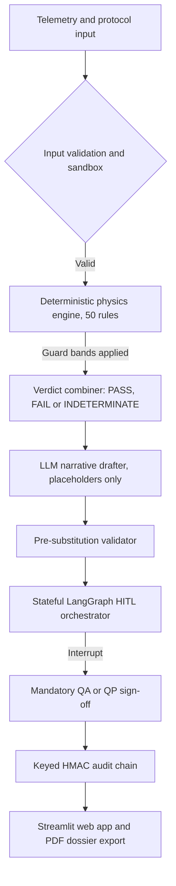
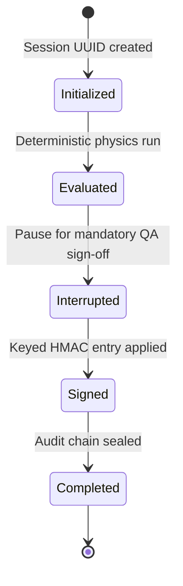

[](#intellectual-property-and-licensing-notice)
[](https://www.python.org)
[](https://docs.pydantic.dev)
[](#standards-and-reference-notes)

# PHARMA_CQV_ENGINE

### Pharma and Cleanroom CQV Decision-Support Agent

**Lead Architect:** Rohit Kumar, PMP, CEng (India), CEA, FSEr (TÜV)
**Reference standards:** EU GMP Annex 1 (2022), ISO 14644-1:2015, ISO 14644-3:2019, GAMP 5 (2nd Ed.), 21 CFR Part 11 (aligned demonstration controls)

---

## Executive Summary

`PHARMA_CQV_ENGINE` is an assistive decision-support engine for pharmaceutical commissioning, qualification and verification (CQV) of cleanrooms. It pairs a deterministic physics and metrology core, which makes every pass, fail or indeterminate ruling, with schema-constrained LLM narrative drafting, which only writes prose around values the core has already computed.

It is designed around GxP principles (traceability, audit trail, human sign-off), but it is a **pilot and portfolio project**. It has not been validated as a GxP system and must not be used for real GMP disposition decisions.

---

## System Architecture and Gate Flow



---

## State Machine and Audit Lifecycle



The audit chain is **tamper-evident**, not immutable: any edit, removal or reordering of an entry fails verification, but only for someone holding the signing key.

---

## Core Design Principles

* **Rulings come from code, not the LLM.** Every compliance decision is made by a deterministic Python function in `pharma_cqv_core/`.
* **Three-state verdicts.** Each gate returns PASS, FAIL or INDETERMINATE (or NOT_APPLICABLE). The overall verdict is FAIL if any gate fails, otherwise INDETERMINATE if any gate is indeterminate, otherwise PASS.
* **Simple-acceptance guard bands.** A reading that meets the nominal limit passes. A reading inside the instrument uncertainty band is INDETERMINATE. A reading beyond the band fails.
* **Explicit units and instrument linkage.** Every reading carries a unit and a linked calibrated instrument. Ambiguous units are rejected, not guessed.
* **Source-tagged criteria.** Each rule carries its source and source type (regulatory, referenced standard, or project URS).
* **The LLM writes prose only.** It uses placeholder tokens, never numbers. The document type and the human-review disclaimer are set by code from the verdict.

---

## Core Architecture Modules

* **`pharma_cqv_core/engine.py`**: Deterministic engine evaluating 50 rules across calibration linkage, multi-neighbour pressure cascades (ΔP), ISO 14644-1 sampling locations, Grade A sample volumes, unidirectional air velocity, and HEPA filter integrity.
* **`pharma_cqv_core/validator.py`**: Pre-substitution guard that blocks stray digits and verdict-contradicting wording in LLM draft narratives.
* **`graph_orchestrator.py`**: Stateful human-in-the-loop workflow managing the QA sign-off interrupt and the keyed-HMAC audit chain.
* **`app_pharma_cqv_sentry.py`**: Streamlit command center with traceability tables, protocol gap review and ReportLab PDF dossier export.

---

## Quickstart and Local Installation

Clone the repository and run the test suite locally (for example in VS Code or Cursor):

```bash
# 1. Install locked dependencies
pip install -r requirements.lock

# 2. Run the 30-case deterministic regression suite
python tests/test_core.py

# 3. Run the MCP server and HITL workflow integration tests
python tests/test_orchestration_and_mcp.py

# 4. Launch the Streamlit command center
streamlit run app_pharma_cqv_sentry.py
```

Keep the audit-chain signing key in an environment variable or Streamlit secrets. Never commit it to the repository.

---

## Intended Use and Limitations

* **Assistive pilot only.** The engine supports a qualified engineer's review. Generated narratives are drafts and require Qualified Person or QA human electronic sign-off before any disposition.
* **Not validated.** This is not a validated GxP system, and nothing here is a regulatory compliance claim.
* **Synthetic data only.** Public deployments evaluate synthetic cleanroom datasets. Do not upload real client or batch data.
* **Author-written test cases.** The reference cases and expected results were written by the author. Passing them shows the code matches the specification, not that the specification is correct. Independent expert review of the rules and cases is recommended before any real-world use.
* **Structured inputs only.** The engine does not extract data from scanned PDFs or free-form protocols.
* **Demonstration-grade controls.** Authentication, role control and the audit trail are a Part 11-aligned demonstration, not a validated implementation.
* **Ephemeral cloud storage.** On Streamlit Community Cloud, container storage is ephemeral. Use the **Download Signed State JSON** and **Import Session** buttons to preserve an audit record. Import verifies the full chain.
* **LLM output is untrusted.** Drafts pass through the pre-substitution validator, and uploaded text is treated as untrusted data that can never change a verdict.

---

## Standards and Reference Notes

Limits and thresholds live in the acceptance-criteria configuration, each with a source citation and source type. Some values are regulatory limits, others are industry guidance or project URS values (for example air changes per hour and airlock pressure steps). Confirm every value against the current primary text before relying on it, and record the project-specific values that apply to your facility.

---

## Intellectual Property and Licensing Notice

**Copyright (c) 2026 Rohit Kumar. All rights reserved.**
This software, its physics engine, schema models and documentation are proprietary. Unauthorized copying, modification, distribution or commercial deployment is prohibited. The software is provided as is, without warranty of any kind.
