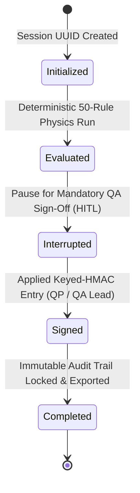

[](https://github.com)
[](https://www.python.org)
[](https://docs.pydantic.dev)
[](https://github.com)

# PHARMA_CQV_ENGINE
### Enterprise Pharma & Cleanroom CQV Decision-Support Agent

**Lead Architect:** Rohit Kumar, PMP, CEng (India), CEA, FSEr (TÜV)  
**Regulatory Domain:** EU GMP Annex 1 (2022) | ISO 14644-1:2015 | GAMP 5 (2nd Ed.) | 21 CFR Part 11-Aligned Controls

---

## 🏛️ Executive Summary
`PHARMA_CQV_ENGINE` is a high-assurance, GxP-compliant pharmaceutical commissioning, qualification, and verification (CQV) decision-support engine. It bridges deterministic physics metrology with schema-constrained LLM narrative generation to automate cleanroom qualification workflows while maintaining strict intellectual property protection.

---

## 📊 System Architecture & Gate Flow
The following sequence outlines how telemetry and protocol data flow through our deterministic verification core, pre-substitution validator, and Human-in-the-Loop audit chain:

```mermaid
graph TD
    A[Telemetry / Protocol Input] --> B{Security Sandbox & RAG Check}
    B -->|Clean / Sandboxed| C[Deterministic Physics Engine (50 Rules)]
    C -->|Simple-Acceptance Guard Bands| D[Verdict Combiner: PASS / FAIL / INDETERMINATE]
    D --> E[Pre-Substitution Validator (Zero Hallucination Guard)]
    E --> F[Stateful LangGraph HITL Orchestrator]
    F -->|Interrupt| G[Mandatory QA / QP Electronic Sign-Off]
    G --> H[Cryptographic Keyed-HMAC Audit Chain]
    H --> I[Streamlit Web App & PDF Dossier Export]
```

---

## 🔄 State Machine & Cryptographic Audit Lifecycle



---

## ⚙️ Core Architecture Modules
* **`pharma_cqv_core/engine.py`**: Deterministic physics engine evaluating 50 rules across calibration linkage, multi-neighbor pressure cascades ($\Delta P$), ISO 14644-1 Table A.1 sampling locations, $1,000\text{ L}$ Grade A sample volume, HVAC ACH / unidirectional velocity ($0.36\text{--}0.54\text{ m/s}$), HEPA H13/H14 installed filter integrity, and Annex 1 Table 6 microbials.
* **`pharma_cqv_core/validator.py`**: Pre-substitution guard that blocks any stray digits, spelled-out number words, or verdict-contradicting terminology in LLM draft narratives.
* **`graph_orchestrator.py`**: Stateful Human-in-the-Loop (HITL) workflow managing mandatory QA electronic sign-off interrupts and cryptographic keyed-HMAC audit trails.
* **`app_pharma_cqv_sentry.py`**: Streamlit command center featuring RTM trace tables, protocol gap reviews, and single-page ReportLab PDF dossiers.

---

## 🚀 Quickstart & Local Installation
Clone the repository and run the automated test suite in your local VS Code / Cursor environment:

```bash
# 1. Install locked dependencies
pip install -r requirements.lock

# 2. Run full 30-case deterministic physics regression suite (100% pass rate)
python tests/test_core.py

# 3. Run MCP server and HITL workflow integration tests
python tests/test_orchestration_and_mcp.py

# 4. Launch the Streamlit command center web app
streamlit run app_pharma_cqv_sentry.py
```

---

## 🔒 Intended Use & Ephemeral Cloud Disclosure
* **Assistive Decision-Support Pilot Only:** All compliance rulings execute inside deterministic Python functions (`pharma_cqv_core/`). Generative narratives require mandatory Qualified Person (QP) / QA human electronic sign-off.
* **Synthetic Data Only:** Public deployments evaluate synthetic cleanroom datasets only.
* **Ephemeral Cloud Storage:** On Streamlit Community Cloud, container storage is ephemeral. Use the built-in **Download Signed State JSON** and **Import Session** buttons for durable audit preservation.

---

## 📜 Intellectual Property & Licensing Notice
**Copyright (c) 2026 Rohit Kumar. All Rights Reserved.**  
This software, core physics engines, schema models, and associated documentation are proprietary commercial assets. Unauthorized copying, modification, distribution, or commercial deployment of this code, via any medium, is strictly prohibited.